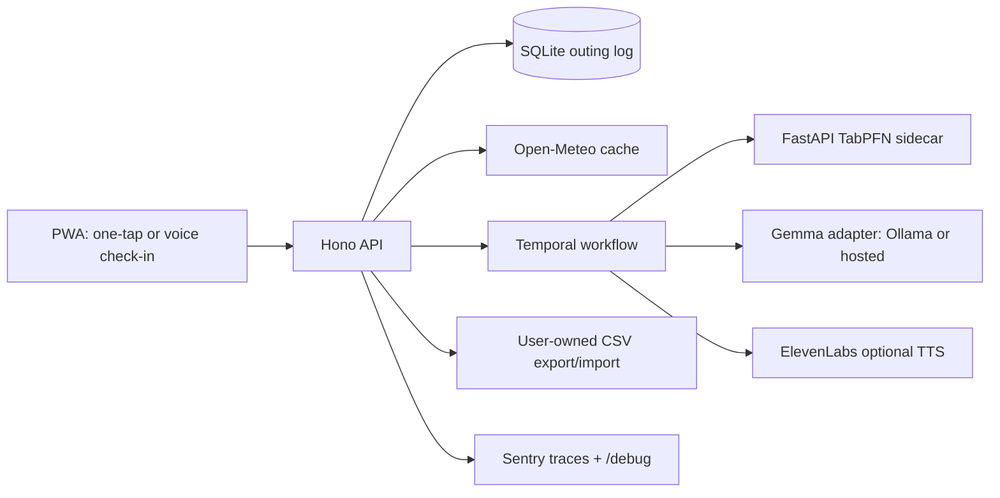

# Outside Window

Outside Window is a personal agent for finding a realistic time to go outside
today. It combines a one-tap screen, durable local outing log, strict quest
output validation, and an offline-safe Gemma adapter. Weather, model
evaluation, voice, and Temporal deployment are explicit next integrations.

> Built new in this repository on October 7, 2026 for the DEV Hacktoberfest
> 2026 Open-Source AI Challenge, Week 1 theme "Touch Grass". Synthetic seed
> rows are marked as synthetic and are not presented as real observations.

## Four-day plan

| Day | Milestone | Proof |
| --- | --- | --- |
| 1 | Foundation and local demo: API, SQLite outing log, CSV import/export, contracts, one-tap check-in | `npm test`, `npm run dev`, `GET /health` |
| 2 | Prediction loop: Open-Meteo cache, feature builder, TabPFN sidecar, leave-one-out evaluation and fixed-6pm baseline | `python prediction/eval.py` prints Markdown scores |
| 3 | Agent loop: Ollama/Gemma adapter with strict JSON, ElevenLabs audio cache, Temporal per-user-day workflow and recovery test | workflow tests and a local one-tap demo |
| 4 | Product polish: PWA screen, Sentry tracing, Render worker/service, debug page, README/DEV post and deployment smoke test | Docker Compose and Render deploy checklist |

## Architecture



## Setup in under five minutes

```powershell
npm install
Copy-Item .env.example .env
npm test
npm run seed
npm run dev
```

Open `http://localhost:8787/`. `npm run seed` creates only clearly labelled
synthetic observations, useful for exercising the UI and exports. For the
complete demo, load the recommendation, accept or skip the quest, and inspect
the resulting row at `/api/outings` or download `/api/export`.

The prediction demo is opt-in: run `python prediction/eval.py --demo` to
generate clearly labelled synthetic rows and print the leave-one-out comparison.
Running it without `--demo` evaluates nothing. Weather requests use
two-decimal-place coordinates and a date-keyed cache so precise locations are
not sent to Open-Meteo and nearby requests can share a response.

## Open vs closed

**Open:** SQLite data stays local by default; CSV export/import is plain text;
the Gemma provider is an adapter and can use offline Ollama or a hosted
endpoint; the prediction service is a separately inspectable Python process.

**Closed or external:** Open-Meteo receives only coarse-rounded coordinates
when weather is enabled. ElevenLabs receives only the generated nudge text
when TTS is enabled. Sentry receives configured telemetry. No outing history
or raw voice recordings are sent by this repository. API usage, hosted Gemma,
ElevenLabs, Render, and Sentry can cost money; the offline path is the
recommended demo path.

## Honest limitations

The current recommendation is a transparent demo heuristic, not a validated
personal prediction. The model needs a user's real outing history and enough
varied examples; synthetic rows must not be used to judge accuracy. Weather,
AQI, free-slot detection, full Temporal orchestration, voice, and Sentry are
staged integrations. TabPFN may be too heavy for small Render instances, so
the deployment design keeps it as a sidecar.

## Credits

Runtime libraries: Hono, Node SQLite, Zod, TypeScript, Vitest, FastAPI,
SQLite, Temporal, Ollama, TabPFN, Open-Meteo, ElevenLabs, Sentry, and Render.
No code is copied into this repository; integrations will follow their official
documentation and terms.
